# Recipe Finder – Figma → Flutter

A free Figma Community recipe-app design built as a Flutter app for Android and the web, wired to a live recipe API. You can save recipes and build a shopping list, and both still work offline.

**Live demo (web):** [ianquilatanwe.github.io/recipe-finder-flutter](https://ianquilatanwe.github.io/recipe-finder-flutter/) · **Android APK:** [v1.0.0 on GitHub Releases](https://github.com/ianquilatanwe/recipe-finder-flutter/releases/tag/v1.0.0)

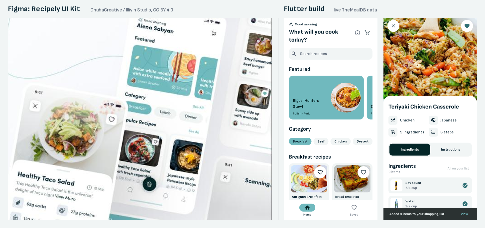

| Home | Recipe | Instructions | Saved |
| --- | --- | --- | --- |
| 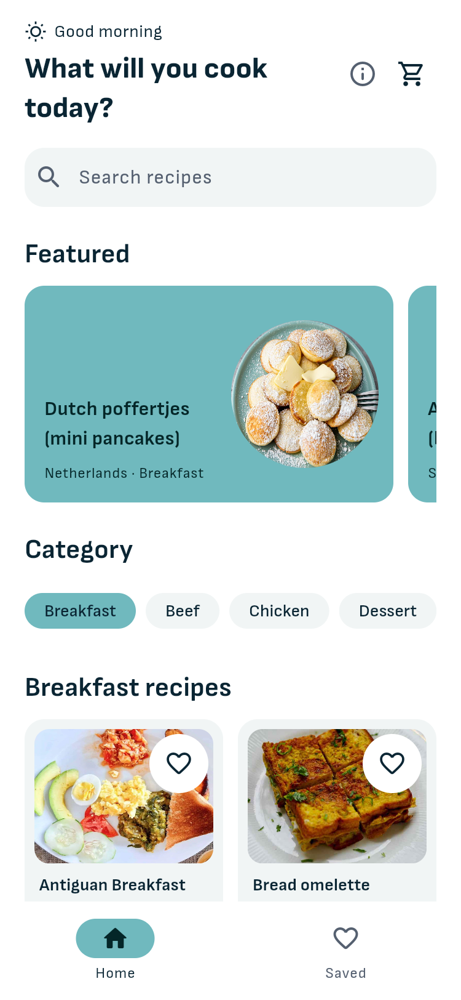 | 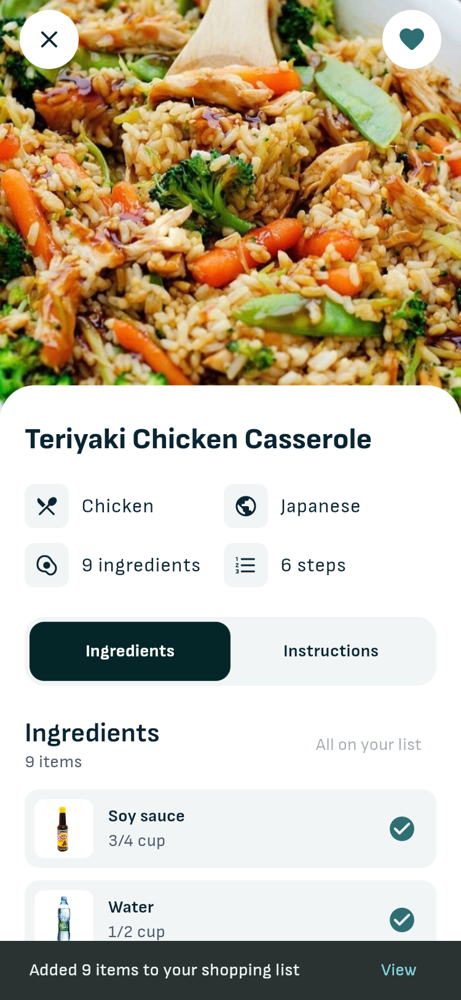 | 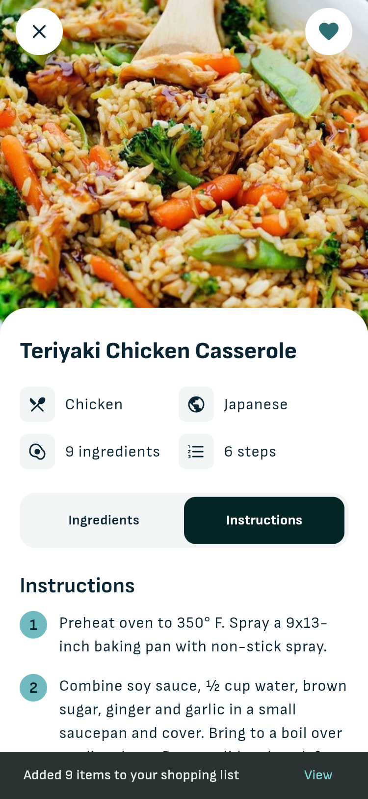 | 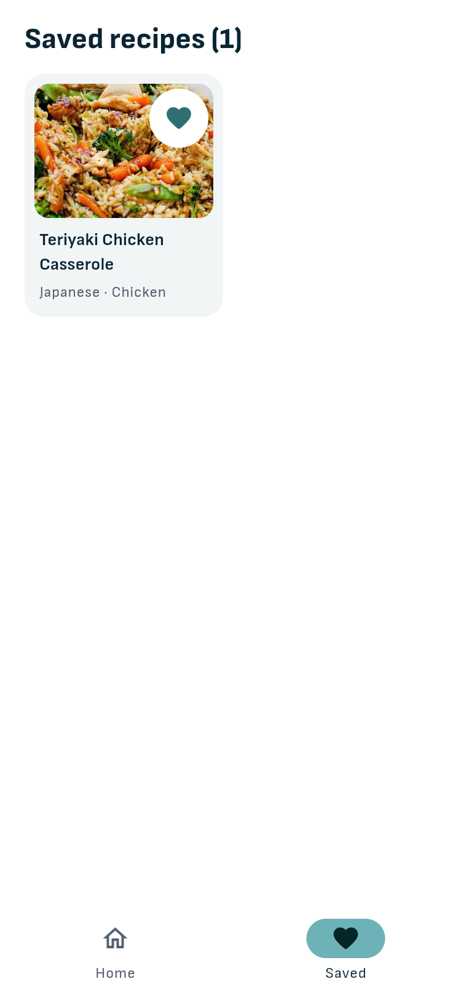 |

| Shopping list: by dish | Shopping list: all items |
| --- | --- |
| 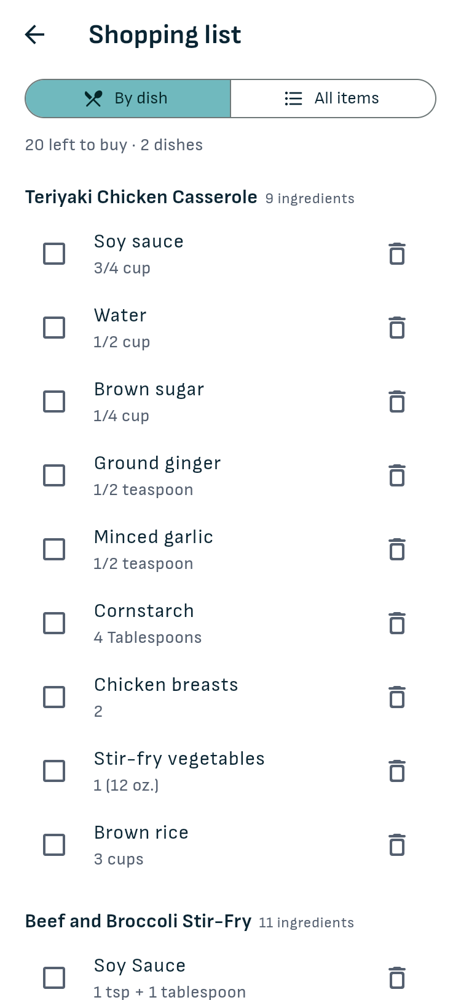 | 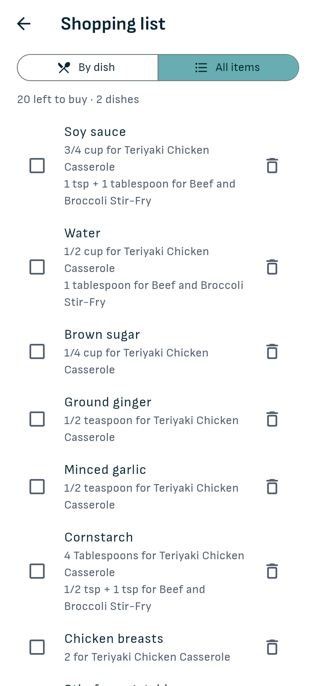 |

| Loading | No results | Offline | Server error |
| --- | --- | --- | --- |
| 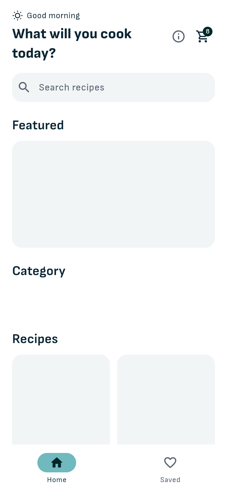 | 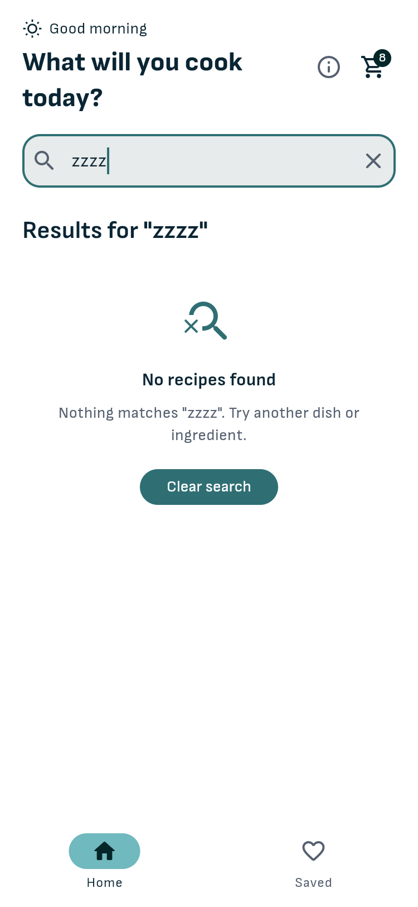 | 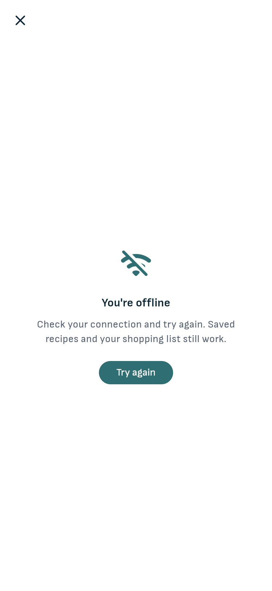 | 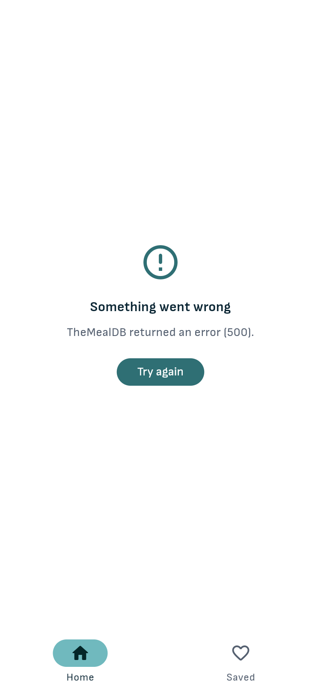 |

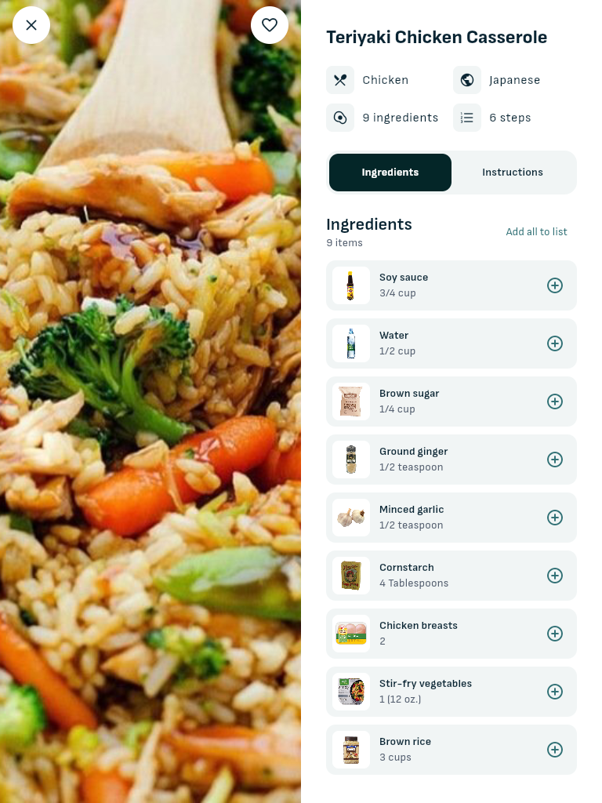

## What I built

**From the design**
- Matched the Recipely home and recipe screens: greeting and cart, Featured carousel, Category chips, recipe cards with a heart, and a full-bleed photo under a rounded sheet with info tiles, the dark Ingredients / Instructions toggle and ingredient rows with thumbnails.
- Responsive from 320 px phones to tablets and 1440 px desktops: bottom bar on phones, side rail on wide screens, 1 to 6 grid columns, and the recipe page splits into photo + details from 720 px.

**Design → code decisions**
- **Fixed what failed WCAG:** the kit puts white text on its light teal (2.2:1) and uses light grey captions (2.6:1). Teal surfaces now carry the kit's dark ink (7.1:1), captions use a darker grey (6.4:1), and teal links use a deeper teal (5.8:1).
- **Mapped the design to the real data:** TheMealDB has no calories, cooking time or nutrition, so the four nutrition tiles show category, cuisine, ingredient count and step count. Ingredient amounts are text ("3/4 cup"), so the design's quantity stepper became add/remove to the shopping list.
- **Made the "cart" a shopping list:** "Add all to cart" adds the recipe's ingredients to a shopping list, and the confirmation names the dish. Two views:
  - **By dish:** one section per recipe.
  - **All items:** one row per ingredient, saying which dish each amount is for ("3/4 cup for Teriyaki…, 1 tsp for Beef and Broccoli…"). Ticking or removing a combined row applies to every dish.

  Both views have checkboxes, Clear checked and Undo. Amounts are free text, so they're listed per dish rather than added up, and an ingredient the API lists twice in one recipe becomes one item ("1 tsp + 1 tablespoon").
- **Filled in what a static design leaves out:** loading skeletons, empty, error and offline states, busy and disabled buttons, keyboard focus rings, and 200% text.
- **Left out:** the camera "scan" button, notifications and profile tabs (no backing feature).

**Data**
- Live recipes from [TheMealDB](https://www.themealdb.com): categories, recipes by category, search, recipe details and random "Featured" picks.
- The API's quirks are handled in one place ([`lib/api.dart`](lib/api.dart)):
  - its 20 numbered ingredient fields become a list;
  - its instructions become numbered steps;
  - `"meals": null` means "no results", not an error.
- Requests time out after 10 s. "No connection" and "server error" get different messages, and each has Try again.
- Pull to refresh on Home.

**Offline**
- Saved recipes are stored whole on the device, so they open with no connection; the shopping list is local too. Removing either offers Undo.
- When the network is down, screens say "You're offline" and point to what still works.

**Accessibility**
- Every icon button has a label ("Save Teriyaki Chicken Casserole", "Shopping list, 3 items"). Tap targets are 48×48 dp. Photos are marked decorative next to their titles.
- Usable at 200% text at small-phone width. A test enforces this on every screen (see below).
- Keyboard: Tab order follows the layout, Enter opens a recipe, and cards show a clear focus ring (keyboard only).
- Full results in [docs/ui-standards-report.md](docs/ui-standards-report.md).

**Web**
- Each recipe has its own URL (`/#/recipe/52772`) that survives refresh and can be shared.
- Page title, description, social preview image, favicon and app icons.

## Stack

Flutter 3.44 · Dart 3.12 · Material 3. Packages:

| Package | Why |
| --- | --- |
| `flutter_riverpod` | State: the async loading / error / data states for each request, and the saved and shopping lists |
| `http` | HTTP that also works on the web (Dart's built-in client doesn't) |
| `shared_preferences` | Keeps saved recipes and the shopping list on the device |

The font (Sofia Sans, OFL) and icons are bundled, so the app downloads no fonts at runtime.

## How the code is organised

Screens only lay things out. Data access and stored state each live in one file.

| File / folder | What's in it |
| --- | --- |
| [`lib/api.dart`](lib/api.dart) | TheMealDB client, models, error types, and the Riverpod providers that fetch data. Tested in [`test/api_test.dart`](test/api_test.dart) |
| [`lib/store.dart`](lib/store.dart) | Saved recipes and shopping list (Riverpod `Notifier`s saved to `shared_preferences`), and `combine()` for the All items view. Tested in [`test/store_test.dart`](test/store_test.dart) |
| [`lib/main.dart`](lib/main.dart) | App, routes (`/`, `/recipe/<id>`, `/shopping`), bottom bar / side rail |
| [`lib/screens/`](lib/screens) | Home, Recipe, Saved, Shopping list |
| [`lib/widgets/`](lib/widgets) | Recipe card + grid sizing, save button, status view (empty / error / offline), `FocusCard` (keyboard focus ring), `showSnack` (every snackbar), About & credits |
| [`lib/theme.dart`](lib/theme.dart) | Colours from the kit (contrast-fixed), font, component themes |
| [`test/screens_test.dart`](test/screens_test.dart) | Every screen (both shopping views) at 3 sizes × 100% / 200% text: no overflow, 48 dp targets, labels, contrast. Offline and error states, snackbars, combined shopping rows |
| [`.github/workflows/pages.yml`](.github/workflows/pages.yml) | Analyze, test, build and deploy the web app to GitHub Pages on each push |

### Architecture choices

Flutter's [architecture guide](https://docs.flutter.dev/app-architecture) splits apps into services, repositories, view models and views. Here that maps to:
- **Service:** `MealApi` (HTTP, error types, parsing).
- **Repository / single source of truth:** the Riverpod providers in `api.dart` and `store.dart`. For example, `recipeProvider` decides between the saved copy and a fetch, so screens don't have to.
- **View models:** Riverpod `Notifier`s for saved recipes and the shopping list.
- **Views:** the screens, which only lay things out.

Two simplifications are deliberate at this size (4 screens, 1 API): there are no separate repository classes and no `data/` / `ui/` folders. Riverpod already provides caching, dependency injection and test overrides (the tests swap in a fake API with one line). In a bigger app or a client codebase with those layers, I'd follow theirs.

### Reviewed

Before publishing, the code went through review passes for correctness (`code-review`), Flutter architecture, and reuse / simplification / efficiency, repeated until a pass found nothing. Fixes from those passes include:
- the "View" snackbar action still works after leaving the recipe page;
- a recipe or category that failed offline loads on the next visit after reconnecting;
- un-saving keeps you on the recipe, with Undo;
- Undo puts items back where they were;
- Featured and search results open with no extra request;
- cards load ~45 KB previews instead of ~125 KB photos;
- the Breakfast grid starts loading at launch.

Each fix has a test.

## Run it

```bash
flutter pub get
flutter run -d chrome
```

On Android: `flutter run` with a device connected, or `flutter build apk --release` (the APK is in `build/app/outputs/flutter-apk/`).

Checks:

```bash
flutter analyze
flutter test
```

## Credits

- Design: [Recipely – Food Recipe Mobile App UI Kit](https://www.figma.com/community/file/1160186880726418317) by DhuhaCreative, published by Illiyin Studio, licensed [CC BY 4.0](https://creativecommons.org/licenses/by/4.0/). Changes: colours darkened for contrast, nutrition tiles replaced with recipe facts, the quantity stepper replaced with a shopping list, and the scan/notification/profile features left out. Credits are also in the app (ⓘ button).
- Recipes and images: [TheMealDB](https://www.themealdb.com), using its free test key for development and educational use. Because of that key, this demo isn't published to an app store.
- Font: [Sofia Sans](https://github.com/lettersoup/Sofia-Sans), SIL Open Font License ([`assets/fonts/OFL.txt`](assets/fonts/OFL.txt)).

Built by [Ian Quilatan](https://github.com/ianquilatanwe), available for small Flutter and frontend jobs [on Upwork](https://www.upwork.com/freelancers/~011c7ba66b3e0501a5).
